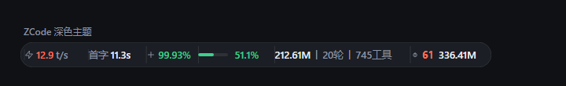
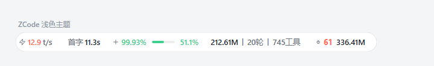

# Zcode-Status-TypeBar

给 ZCode 桌面客户端用的本地 token 用量状态条：在聊天输入框正下方显示一条悬浮胶囊条，
实时展示最近一次请求的速度与首字延迟、缓存命中、上下文占用、会话累计 token 与轮次、
当前会话错误、今日合计。另附带一个只读 MCP 工具 `token_usage`，可以直接在对话里查询用量。

<p align="center">
  
  
</p>

<p align="center"><sub>上图由本机真实数据渲染：速度 12.9 t/s、首字 11.3s、缓存命中 99.93%、上下文 51.1%</sub></p>

Windows 客户端注入式工具，通过改写 ZCode 的 `app.asar` 生效。

## ⚠️ 先读这一段：它会修改客户端文件

**这不是官方插件市场里的扩展。** ZCode 的插件体系目前不支持注入 UI —— 插件只能贡献
skills / commands / hooks / MCP servers / agents，hook 只在 CLI 进程里跑（`zcode.cjs` 里
`executeJavaScript` 和 `BrowserWindow` 的出现次数都是 0），也没有 `statusLine` 这类事件。
所以要做出悬浮状态条，只能改写客户端的 `app.asar`。

这意味着：

- 安装会**修改** `%LOCALAPPDATA%\Programs\ZCode\resources\app.asar`（约 340 MB）；
- 安装器会先把它备份成 `app.asar.zusage-backup-<版本>`，卸载可完整还原；
- **ZCode 每次升级都会覆盖 `app.asar`，状态条会消失**，需要重新运行安装器；
- 杀毒软件可能因「修改客户端文件 + 注入 JS」报毒，这是启发式误报，源码全部公开可审阅；
- 使用风险自负。请确保你有权这样做。

如果你不能接受修改客户端文件，本项目不适合你。不接受也没关系。

**所有源码都在本目录**，只有 5 个文件、约 5000 行，安装前可以自己读一遍：
`install.py` 和 `inject-main.cjs` 是最该先看的两个。

## 原理：它是怎么工作的

理解这四条链路，就能判断出数据从哪来、出了问题该查哪里。

### 1. 注入：一行 import 挂上主进程

`app.asar` 里的主进程入口是 `out/main/index.js`（打包后的单文件）。安装器在这个文件末尾
追加一行：

```js
;import("file:///C:/Users/<你>/.zcode/zcode-token-usage-statusbar/inject-main.cjs")
  .then(() => null, (e) => console.error("[zusage] load failed", e));
```

asar 格式是「Chromium pickle 头 + JSON 文件树 + 顺序拼接的数据区」，改了文件长度就必须
同步修正头部的 `size` / `offset` / SHA256 `integrity`，否则 Electron 会拒绝加载整个包。
安装器做的是**完整重打包**：只替换入口文件，其余 27844 个文件逐字节复制，临时包校验通过后
才 `os.replace` 换入原文件。

### 2. 触发：监听数据库写入，而不是轮询

`inject-main.cjs` 用 `fs.watch` 监听 `~/.zcode/cli/db/` 目录。ZCode 每完成一次模型请求就往
`db.sqlite` 写入，触发一次查询。配合去抖（300ms）和限频（默认 1.5s），**完全空闲时零进程
零轮询**，只保留一个 30s 的兜底心跳 —— 因为 `fs.watch` 的事件不保证送达（Node 官方文档
明确说明）。

查询进程是常驻的：`zusage.py serve` 走 stdin/stdout 行协议，省掉每次拉起 Python 解释器
的 60–100ms 开销。进程意外退出自动重启，30 秒内连续退出 3 次判为不稳定，回退到一次性 spawn。

### 3. 取数：只读 SQLite

ZCode 把每次模型请求的用量写进 `~/.zcode/cli/db/db.sqlite`。`zusage.py` 以**只读模式**
（`mode=ro`）打开它，全程只执行 `SELECT`，不写库、不联网。

三张表各管一段：

| 表 | 用途 |
| --- | --- |
| `model_usage` | 每**次模型请求**一行：input / output / cache_read / 首字时间戳 / 耗时 / 错误 |
| `turn_usage` | 每**轮对话**一行：整轮的请求数、工具调用数、重试数、工具错误数 |
| `tool_usage` | 每**次工具调用**一行：工具名、耗时、失败信息 |

底栏的「当前会话」通过客户端自带的一条 IPC 通道（`zcode:sync-active-task-session`）拿到
—— 渲染端把当前焦点会话的 id 上报给主进程，多窗口/分屏时每个 pane 各显示各的。

### 4. 渲染：注入到输入框下方

主进程用 `webContents.executeJavaScript()` 把 `overlay.js`（一个自包含 IIFE，无外部依赖）
注入渲染进程。它用 rAF 每帧跟随输入框卡片定位，把胶囊条贴在卡片下沿外侧的空带里。

配色全部引用客户端的 CSS 变量（`--color-foreground`、`--color-border` 等），所以主题切换
自动跟随 —— 插件不需要监听主题变化再重绘，只需要观察 `<html>` 上 `.dark` 类有没有翻转。

热更新：主进程每 2 秒比对 `overlay.js` 的 mtime，变了就用 `new Function()` 先验语法，通过了
才重新注入（避免把写到一半的文件载入页面）。

## 数据口径：几个容易误读的地方

**速度是端到端的。** `输出 tokens ÷ 该请求总耗时`，含首字等待与工具往返。它反映你的真实
等待体感，数值比「纯生成速度」小。悬停里同时给出纯生成速度（首 token 之后到完成）做对照：
两者差得远，就说明时间花在了首字而不是生成上。

> 上下文越大、输出通常越少。上下文几十万 token、输出只有几百时，分子小分母大，比值会
> 系统性偏低，看起来「很慢」但纯生成速度并不低。

**首字延迟用时间戳现算。** 客户端写 `time_to_first_token_ms` 列并不可靠 —— 实测约三分之一的
completed 行该列为 NULL，直接读会频繁显示成横杠。改用 `first_token_at − started_at`，
那列只作兜底。

**缓存命中率保留两位小数。** 实测连续对话里命中率在 99.2%–99.98% 之间，99.968% 用
`toFixed(0)` 或 `toFixed(1)` 都会变成「100%」—— 而命中 100% 在物理上不可能（每轮总有
新增内容没进缓存），那个假的完美数字反而让人以为算错了。

> 分母只能用 `input`，不能用 `cache_read + cache_creation`：实测 ZCode 从不写
> `cache_creation`（全库 1571 条记录该字段全是 0），那样算会得到真正的 100%。

**错误不含主动中断。** 你点「停止」产生的 `cancelled` 不计入，否则中断几次就飘红。
只有真报错（`status='error'`）、工具失败和模型重试才计数。

## 系统要求

| 项目 | 要求 |
| --- | --- |
| 操作系统 | Windows 10 / 11（本项目按 Windows 路径编写） |
| ZCode | 桌面版，**已验证 3.15.3** |
| Python | **3.8+**。一键安装会在缺失时自动装上；手动方式才需要事先准备。已验证 3.12.7 |
| 权限 | ZCode 装在用户目录（默认 `%LOCALAPPDATA%\Programs\ZCode`）时无需管理员；装在 `Program Files` 时需管理员终端 |

ZCode 需要至少启动过一次，让它生成 `%USERPROFILE%\.zcode\cli\db\db.sqlite`。

## 安装

### 方式 A：一键安装（推荐）

1. 下载 zip 并解压到任意目录（路径里有空格或中文都没关系）；
2. **完全退出 ZCode** —— 关掉所有窗口，并在系统托盘（右下角隐藏图标里）右键 ZCode 图标选择「退出」。只关窗口不够，托盘进程还在时会占用文件；
3. 双击解压出来的 **`install.bat`**。

就这一步。它会自动：

- 找到你的 Python 3；**没装的话自动装上**（优先用 `winget`，没有 winget 就从官网下静默安装包，约 26 MB），所以你不需要事先准备 Python；
- 检查 ZCode 是否真的退出了，没退出就停下并告诉你怎么做（它不会替你杀进程）；
- 定位 `app.asar`；如果 ZCode 装在 `Program Files` 这类需要管理员权限的目录，会自动弹 UAC 提权后重跑自己；
- 运行 `install.py` 完成注入与 MCP 注册；
- 每一步都有中文提示，失败会说明原因和下一步怎么办。

### 方式 B：手动运行（习惯看命令行的）

先完全退出 ZCode，然后：

```bat
cd /d "C:\Users\你\Downloads\Zcode-Status-TypeBar"
py -3 install.py
```

没有 Python 就用 `python install.py`。如果提示 `python` 不是内部或外部命令，请先装 Python 3 并勾选 Add to PATH，或者干脆用方式 A。

### 装了些什么

安装器会自动完成四件事：

1. 复制插件文件到 `%USERPROFILE%\.zcode\Zcode-Status-TypeBar`；
2. 生成 `config.json`（记录当前 Python 路径和 `app.asar` 路径）；
3. 备份并注入 `app.asar`：在主进程入口 `out/main/index.js` 末尾追加一条动态 import，同时修正 asar 头部的文件大小、偏移和 SHA256 完整性信息；
4. 把 `usage_mcp.py` 注册到 `%USERPROFILE%\.zcode\cli\config.json` 的 MCP server 列表里。

成功时最后几行类似：

```
[4/4] 已注册 MCP server: C:\Users\你\.zcode\cli\config.json

安装完成。请启动 ZCode：输入框下方会出现 token 用量状态条。
```

安装器会先把原 `app.asar` 备份成 `app.asar.zusage-backup-<ZCode版本>`，放在 ZCode 的 `resources` 目录里。

### 启动并验证

启动 ZCode，打开任意一个聊天会话。输入框下方出现状态条即安装成功。

验证清单：

- [ ] 输入框下方出现胶囊状态条，至少能看到「速度首字 / 上下文 / 会话累计 / 会话错误 / 今日合计」中的几项；
- [ ] 鼠标悬停条目能看到明细；
- [ ] 点击 ⚙ 能打开设置面板；
- [ ] 在新会话里问「查询今天的 token 用量」，模型能调用 `token_usage` 工具（若没有，重启一次 ZCode）。

> 新会话在第一次模型请求完成前会显示 0，这是正常的：数据从 `db.sqlite` 读取，请求完成后才落库。

## 安装器参数（可选）

```text
python install.py [选项]

  --asar PATH      手动指定 app.asar 路径（自动查找失败时使用）
  --dest PATH      自定义插件安装目录（默认 %USERPROFILE%\.zcode\Zcode-Status-TypeBar）
  --skip-mcp       只装状态条，不注册 MCP server
  --force          跳过 ZCode 进程检查（仅建议对 asar 副本做测试）
```

ZCode 默认安装在以下位置，安装器会自动查找：

- `%LOCALAPPDATA%\Programs\ZCode\resources\app.asar`
- `%PROGRAMFILES%\ZCode\resources\app.asar`
- `%PROGRAMFILES(X86)%\ZCode\resources\app.asar`

如果自定义了安装位置，例如：

```bat
python install.py --asar "D:\Apps\ZCode\resources\app.asar"
```

## 配置说明

安装后配置位于 `%USERPROFILE%\.zcode\Zcode-Status-TypeBar\config.json`。显示项、语言、上下文窗口建议直接在状态条的 ⚙ 面板里改，即时生效；`config.json` 里的查询节流、心跳、热更新等参数会在几秒内生效。修改 `python_path` 或 `asar_path` 后建议重启 ZCode（必要时重新运行安装器）。

| 字段 | 默认值 | 说明 |
| --- | --- | --- |
| `python_path` | 安装器使用的 Python | 主进程调用 `zusage.py` 用的解释器；Python 换位置后要改这里或重跑安装器 |
| `asar_path` | 自动检测 | ZCode 的 `app.asar` 路径，升级/重装时用于重新注入 |
| `activity_min_ms` | `1500` | 数据查询的最小间隔（毫秒），防止频繁拉起查询 |
| `heartbeat_ms` | `30000` | 空闲时兜底拉取间隔；完全空闲时不会开进程轮询 |
| `hot_reload` | `true` | 监听 `overlay.js` / `zusage.py` 的 mtime 并热更新；发布稳定版可设 `false` |
| `context_window` | `1000000` | 上下文窗口回退值。状态条优先读客户端原生 UI 或模型目录，读不到才用它 |
| `lang` | `zh` | 状态条 / CLI / MCP 的默认语言：`zh` 或 `en` |
| `resident` | 缺省 `true` | 使用常驻 Python 查询进程；设为 `false` 则每次查询启动一次性进程 |
| `remote` | 无 | SSH 远程会话支持，见下文 |

`config.example.json` 是一份不含本机绝对路径的示例。

## 使用说明

### 状态条条目

底栏固定五项，从左到右：

| 条目 | 显示内容 | 悬停 |
| --- | --- | --- |
| 速度 · 首字 · 缓存 | 最近一次完成请求的输出速度（t/s）、首字延迟、缓存命中率 | 纯生成速度（首字之后）、单次耗时、命中/输入 token、模型名 |
| 上下文 | 当前会话上下文占窗口的百分比 + 微进度条 | 已用 token / 窗口容量；超限被拒时红色闪烁并弹出提示 |
| 会话累计 | 当前会话累计 tokens、轮数、工具调用次数 | input/output/cache read/思考、重试、代码变更行数 |
| 会话错误 | 当前会话的失败次数 | 轮次报错 / 工具失败 / 重试分别计数，并按工具列出 |
| 今日合计 | 今天所有会话的 token 消耗 | input/output/cache read、请求数、重试 |

前四项的数值各带三档配色（绿 / 黄 / 红），阈值按端到端口径标定。

**第一项是因果链，并排看才能定位瓶颈：**

```
缓存命中 99.93%  →  几乎不用重算上下文  →  首字 11.3s  →  端到端 12.9 t/s
```

- 命中率正常但首字仍长 → 上下文本身太大（几十万 token），换长上下文模型或压缩会话才有用；
- 命中率明显下降 → 首字必然被拖长，因为模型得现场重算整段上下文。

其余口径（端到端速度、两位小数、不含主动中断）见前文「数据口径」一节。

子代理的逐个明细仍可通过 MCP 工具查询（`token_usage` 的 `session:<id前缀>` 与
`workspace:<关键词>`），底栏不再单列子代理项。

### 设置面板

点击状态条右侧 ⚙：

- 勾选/取消条面上的显示项（保存在浏览器 localStorage，按客户端共享）；
- 上下文窗口：留空 = 自动（原生 UI > 模型目录 > `config.json` 的 `context_window`）；
- Language：中文 / English。

### 上下文超限提示

如果某次请求因超出上下文窗口被客户端拒绝，状态条会变红闪烁并自动弹出提示气泡，给出回滚、换更大窗口模型、新开会话接手等处理建议，并显示会话 ID 方便复制。

## MCP 工具 `token_usage`

安装器会把 `usage_mcp.py` 注册为本地 stdio MCP server，名字是 `Zcode-Status-TypeBar`。工具只读查询 `%USERPROFILE%\.zcode\cli\db\db.sqlite`。

| `scope` | 返回内容 |
| --- | --- |
| `current`（默认） | 当前会话 + 今日合计 |
| `today` | 今日所有会话汇总 |
| `week` | 近 7 天每日用量 |
| `days:N` | 近 N 天每日用量 |
| `sessions` / `sessions:N` | 最近 N 个会话（默认 10） |
| `models` / `models:days` | 按模型聚合（默认近 7 天） |
| `session:<id前缀>` | 指定会话明细，含按模型和子代理 |
| `workspace:<目录关键词>` | 按工作区聚合主会话 + 子代理 |

示例提问：

- 「查询当前 token 用量」
- 「用 token_usage 看最近 7 天每天的消耗」
- 「看 workspace:my-project 的总用量」

如果不需要 MCP，重新运行安装器时加 `--skip-mcp`，或手动删除 `%USERPROFILE%\.zcode\cli\config.json` 中对应的 server 条目。

## SSH 远程会话支持（可选）

当 ZCode 桌面客户端连接的是远端 `zcode-server` 时，会话数据落在远端机的 `~/.zcode/cli/db/db.sqlite`，本地库查不到。可在本机 `config.json` 增加 `remote` 段，让插件通过 SSH 到远端执行同一份 `zusage.py`：

```json
{
  "remote": {
    "enabled": true,
    "ssh": "my-server",
    "script": ".zcode/Zcode-Status-TypeBar/zusage.py",
    "python": "python3",
    "timeout_s": 6,
    "host_label": "dev-server"
  }
}
```

- `ssh` 可以是 `~/.ssh/config` 里的主机别名，也可以是 argv 数组，例如 `["ssh", "-p", "2222", "user@host"]`，或借道 `docker exec` / `wsl` 等通道；
- `script` 是远端 `zusage.py` 的路径（相对于远端用户家目录或绝对路径），需要先把本插件复制到远端；
- 远端只需要 `zusage.py`，**不要**在远端配置 `remote` 段，避免递归；
- 建议配置 SSH 公钥登录；查询有超时保护，失败只影响数字显示，不影响客户端。

只在聚焦远端会话且本地库没有该会话时才会发起 SSH，切回本地会话后恢复本地事件触发。

## 升级与客户端更新

- **插件升级 / 修复**：关闭 ZCode，重新运行 `install.py`。安装器会先移除旧注入行再写入新行，重复运行是幂等的。
- **ZCode 客户端升级**：客户端更新会覆盖 `app.asar`，状态条会消失，MCP 也可能需要重启。升级后重新运行 `install.py` 即可。安装器会重新检测路径并生成对应版本的备份。
- 备份文件 `app.asar.zusage-backup-<版本>` 与 `app.asar` 同目录，每个客户端版本一份（约 340 MB）。确认新版本稳定后可以删除旧版本的备份以释放空间。
- 如果 ZCode 改了主进程入口结构，安装器会报「在 asar 中找不到入口文件」并中止，不会写入半成品。此时需要等待插件适配新版本。
- 配置（`config.json`）在升级时保留，只有 `python_path` / `asar_path` 会被刷新。

## 卸载

关闭 ZCode 后，双击 **`uninstall.bat`**，或手动运行：

```bat
python uninstall.py
```

默认行为：

1. 从当前 `app.asar` 的主进程入口删除注入行，并修正 asar 头部；
2. 从 `%USERPROFILE%\.zcode\cli\config.json` 删除 MCP server 注册；
3. 删除插件目录 `%USERPROFILE%\.zcode\Zcode-Status-TypeBar`。

可选参数：

```text
--keep-files       保留插件目录，只移除注入和 MCP 注册
--restore-backup   用 app.asar.zusage-backup-<版本> 还原客户端
--dry-run          只显示将要执行的操作
--force            跳过 ZCode 进程检查
```

`--restore-backup` 只应在客户端版本没有变化时使用；ZCode 升级后旧备份可能与新版本不匹配，默认的「移除注入」模式更安全。

卸载后建议重新启动一次 ZCode，确认客户端正常。

## 常见问题

**状态条不出现**

1. 确认 ZCode 是**完全退出后重新启动**的，而不是只关闭窗口；
2. 确认插件目录存在：`%USERPROFILE%\.zcode\Zcode-Status-TypeBar`；
3. 在命令行运行 `python "%USERPROFILE%\.zcode\Zcode-Status-TypeBar\zusage.py" now`，能输出用量说明 Python 和数据库正常；
4. 检查 `config.json` 的 `python_path` 是否指向真实存在的 `python.exe`；
5. 如果最近升级过 ZCode，重新运行 `install.py`；
6. 状态条只注入聊天窗口，设置页 / 登录页不会显示；
7. 以上都正常仍然不出现，打开 **帮助 → 开发者工具** 看 Console：没有 `[zusage]` 输出说明注入本身没成功；有 `[zusage] 状态条未挂载` 则说明注入成功但找不到输入框，输出里的 `composerHits` 是各选择器的命中数，ZCode 改版时会用到；在控制台输入 `window.__zusageDiag` 可看更多挂载信息。

**数字一直是 0**

新会话在第一次请求完成前没有数据；`db.sqlite` 在请求完成后才写入。若会话是 SSH 远端会话，本地库没有数据，需要配置 `remote` 段或查看远端库。悬停状态条会提示「不在本地库」。

**提示 spawn failed / Python 无法启动**

`config.json` 里的 `python_path` 失效（Python 升级、卸载或换盘）。改回正确的 `python.exe` 路径，或重新运行 `install.py`。

**MCP 工具 `token_usage` 不出现**

1. 重启 ZCode；
2. 检查 `%USERPROFILE%\.zcode\cli\config.json` 是否有 `Zcode-Status-TypeBar` 条目；
3. 确认条目里的 `command` 和 `args` 路径存在；
4. MCP 注册失败不影响状态条，可以手动按上面的 JSON 结构补上。

**安装时报 Permission denied / 拒绝访问**

ZCode 还在运行，或装在了需要管理员权限的 `Program Files`。完全退出 ZCode；仍失败时用「以管理员身份运行」打开 PowerShell 再执行 `python install.py`。

**安装时报「不是有效的 asar 头部」或「找不到入口文件」**

ZCode 版本与插件不兼容，或 `app.asar` 被其他工具改过。安装器不会修改文件；请确认 ZCode 版本，等待插件适配，或先把 `app.asar` 恢复为原版再试。

**杀毒软件报警**

插件会修改 `app.asar` 并向渲染进程注入 JS，这类行为可能被启发式规则误报。所有源码都在本目录，可自行审阅；只读本地数据库，不联网（可选的 SSH 远程功能除外）。如不放心，可在安装前把 `install.py` 和 `inject-main.cjs` 检查一遍。

## 安全与隐私

- `zusage.py` / `usage_mcp.py` 以**只读**方式打开 `~/.zcode/cli/db/db.sqlite`，只执行 `SELECT`；
- 状态条数据只在本地进程间传递（主进程 → 渲染进程），不上传；
- `usage_mcp.py` 是本地 stdio 进程，不监听端口；
- 唯一的网络行为是可选的 SSH 远程查询（`remote.enabled=true` 时），默认关闭；
- 排障信息（状态条没挂载时的选择器命中数、异常栈）只写 DevTools 控制台，**不落盘、不外发**；
  在控制台可查 `window.__zusageDiag`；
- 安装器会改写 `app.asar` 并保留备份；卸载会移除注入并修正 asar 头部。

## 文件说明

| 文件 | 作用 |
| --- | --- |
| `install.bat` / `uninstall.bat` | 一键入口（GBK 编码，改动前先读 [CONTRIBUTING](CONTRIBUTING.md)） |
| `install.py` | 安装器：复制文件、生成配置、备份并注入 `app.asar`、注册 MCP |
| `uninstall.py` | 卸载器：移除注入、注销 MCP、删除插件目录 |
| `inject-main.cjs` | 主进程 loader：监听数据库、拉起常驻 Python 查询、向窗口注入 overlay |
| `overlay.js` | 渲染进程状态条（自包含 IIFE，跟随主题、支持分屏与热更新） |
| `zusage.py` | 用量查询核心：CLI、`serve` 常驻模式、SSH 远程数据源 |
| `usage_mcp.py` | MCP stdio server，暴露 `token_usage` 工具 |
| `config.example.json` | 配置示例（安装器会生成实际的 `config.json`） |
| `docs/` | 状态条截图（由真实数据渲染） |
| `CHANGELOG.md` | 更新日志 |
| `CONTRIBUTING.md` | 贡献指南（含必须自测的检查项与批处理编码约定） |
| `LICENSE` | GNU AGPL v3 许可 |

## 兼容性与验证记录

- 打包时的客户端：ZCode Desktop **3.15.3**（`out/main/index.js` 入口）；
- 打包时的 Python：**3.12.7**；
- 安装器已在 `app.asar` 副本上完成以下验证：
  - 注入后重新解析 asar，入口文件与 SHA256 校验通过；
  - 其余 27,844 个打包文件逐字节一致；
  - 重复安装幂等（asar 字节级不变）；
  - 卸载后注入行完全移除，全部 27,844 个文件内容与原版一致、完整性哈希全部有效；
  - 用 Electron 自身的 fs 读取路径验证重打包后的 asar 仍可正常解析（`package.json`、
    主进程入口可读且 integrity 校验通过）；
  - MCP 配置合并/移除不影响其他 server。

> 卸载后 `app.asar` 的**整体 SHA256** 与原版不同：重打包会重新序列化 asar 头部
> （键序与空白变化），文件内容本身逐字节一致，Electron 读取不受影响。

ZCode 后续版本可能调整主进程入口或 asar 结构，升级客户端后请先重新运行安装器并观察是否报错。

## 许可

**GNU Affero General Public License v3.0 或更高版本。**

AGPL 是在 GPL 基础上增加的"网络交互"条款：如果你把本项目改造后通过网络提供给用户使用，
也必须向这些用户提供你的修改版源码。

使用风险自负；修改客户端文件前请确保你有权这样做，并保留备份。
